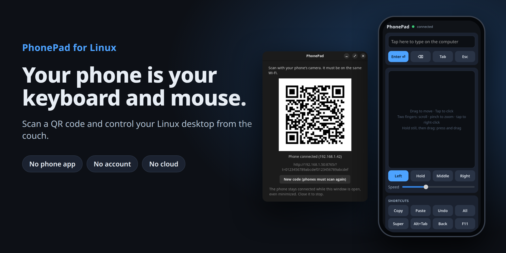
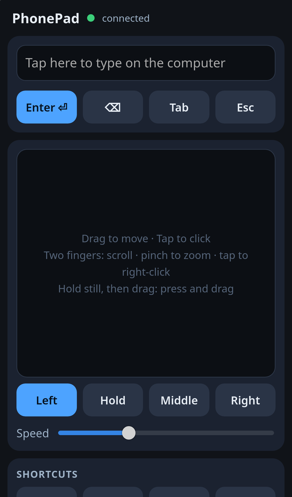
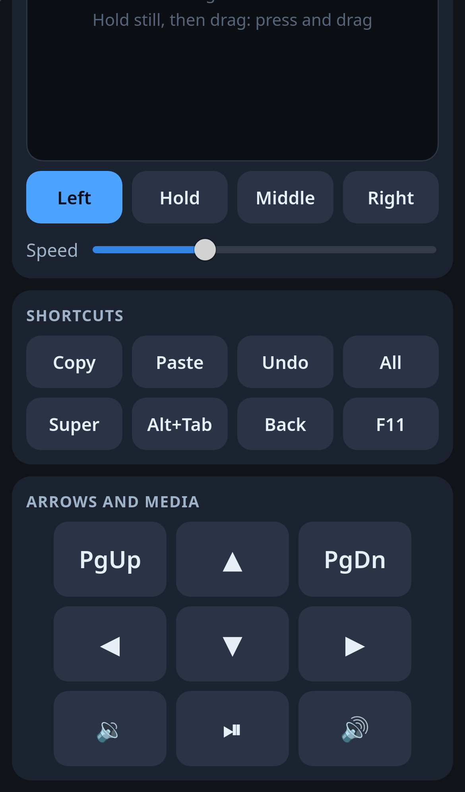
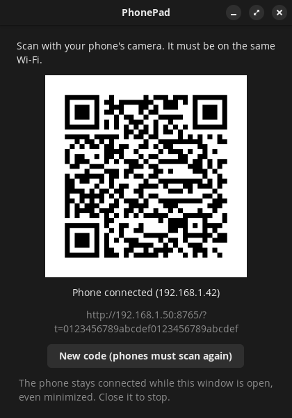

# PhonePad for Linux

**Your phone is your keyboard and mouse.** Scan a QR code and control your Linux desktop from the couch, the bed
or across the room. No phone app, no account, no cloud.

## Why PhonePad

Your computer is plugged into the TV. Your keyboard is on the desk. You just want to pause the video, type one
search and get back to the couch.

PhonePad puts a trackpad and keyboard on the phone already in your hand. There's nothing to install on it, because
the controls are a web page served by your own computer.

- **Ready in seconds.** Open PhonePad, point your camera at the code, and you're in control.
- **One scan, then done.** Pairing is remembered, and a page left open reconnects by itself. On iPhone, add it to
  your Home Screen for a one-tap remote.
- **The whole desktop, not one app.** It acts as a real keyboard and mouse, so it works in every application.
- **Built for modern Linux.** Input goes through the kernel, so it doesn't depend on X11 tools that Wayland
  desktops like COSMIC can't use.
- **Stays in your home.** Your phone talks directly to your computer. No account, no sign-up, no outside server.
- **Tiny and open source.** About 20 KB of Python and GTK, under the MIT License.

## What you get

| | |
|---|---|
|  |  |
| **Trackpad and typing** | **Shortcuts, arrows and media keys** |

| Connect on your computer |
|---|
|  |

| On the trackpad | What it does |
|---|---|
| Drag one finger | Moves the pointer |
| Tap | Left click |
| Hold still, then let go | Right click |
| Hold still, then drag | Press and drag |
| Two fingers: drag / pinch / tap | Scroll / zoom / right click |

Text goes to the computer as you type it, into whatever has focus. Corrections on the phone are applied on the
computer too.

## Install

For Pop!_OS, Ubuntu and other Debian-based desktops:

    wget https://github.com/crash101g/phonepad/releases/latest/download/phonepad_0.1.0_all.deb
    sudo apt install ./phonepad_0.1.0_all.deb

Open **PhonePad** from your app launcher and scan the code. Your phone must be on the same network as the computer.

**If the phone can't connect,** your firewall is the likely cause. With `ufw` on, allow your own network only,
adjusting the address to match yours:

    sudo ufw allow from 192.168.1.0/24 to any port 8765 proto tcp

PhonePad uses the first free port from 8765 to 8768, and the link under the QR code shows which. Guest Wi-Fi
networks often stop devices reaching each other, so use your main network.

If PhonePad says it can't open `/dev/uinput`, log out and back in once. To remove it: `sudo apt remove phonepad`.

### macOS on Apple silicon (experimental)

For M1 or later, on macOS 13 or newer. Mac support has been checked on GitHub's Apple silicon machines, but
**not yet with a real phone on a real Mac**, so please report how it goes.

1. Download `PhonePad-macos-arm64.zip`, unzip it and move **PhonePad** to Applications.
2. The app isn't notarized by Apple, so macOS blocks the first launch. Try to open it, then go to **System Settings →
   Privacy & Security** and choose **Open Anyway**.
3. When asked, turn on PhonePad under **Accessibility**, then quit it and open it again.
4. Allow incoming connections if the macOS firewall asks.

On a Mac, the phone's shortcut buttons become their Command versions, **Super** opens Spotlight, and any character
can be typed, including accents and emoji. The play/pause button is hidden, because a program can't post that key
the same way. New builds may need the Accessibility setting turned off and on again.

### Run from source

    git clone https://github.com/crash101g/phonepad
    cd phonepad
    python3 -m phonepad             # or add --terminal for no window
    packaging/build-deb.sh          # builds the .deb in dist/

On Linux this needs Python 3.10+, GTK 4 with PyGObject, `iproute2` and write access to `/dev/uinput`. On a Mac it
needs `pip install pyobjc-framework-Cocoa`, and `packaging/build-macos.sh` builds the app.

## Where it has been tested

| Setup | Status |
|---|---|
| Pop!_OS 24.04, COSMIC (Wayland), with an iPhone | Tested and working |
| Android | Page tested in emulated Chromium only |
| GNOME, KDE and X11 | Designed to work, not tested yet |
| macOS 14 on Apple silicon | Real input checked by automated tests on GitHub's Macs, not yet with a real phone |

If you try one of these, please open an issue and say how it went.

## Good to know

- **On Linux, typing is limited to a US keyboard.** The computer must use a US layout, since keys are sent as physical key
  presses. Smart quotes and dashes become plain ones. Accented letters and emoji are skipped, and the phone tells
  you how many.
- **Saved links depend on the computer's address.** If your router gives it a new one, scan again. Reserving the
  address in your router avoids this.
- **Wi-Fi only, no Bluetooth.** A web page can't act as a Bluetooth keyboard, and iPhones don't allow it at all.

## Security

Anyone who can use this link can type on your computer as you, so:

- The code is saved in `~/.config/phonepad/token` (on a Mac, `~/Library/Application Support/PhonePad/token`),
  readable only by you. It keeps working until you tap **New
  code**, which replaces it at once. Do that if the link may have leaked, or if you have used it on a network
  you don't trust.
- It serves only while its window is open, and only one phone at a time.
- Only other devices on this computer's own subnet can connect, and this computer itself is refused.
- The code is 128 random bits, so it can't be guessed. Wrong codes are refused, but don't lock anyone out: a
  phone's old tab retrying with an expired code would otherwise block that phone from scanning the new one.
- **It is plain HTTP.** Someone able to watch your network could read the code and anything you type. That's
  a reasonable risk on your home Wi-Fi. Don't use it on public or shared Wi-Fi, and close it when you're done.
- It keeps working at the lock screen, like a real keyboard, so a connected phone can type there.

## Development

    python3 -m unittest discover tests

## Credits and license

PhonePad grew out of the phone remote in
[TVCouchBrowser](https://github.com/crash101g/tvcouchbrowser-desktop), which controls only its own browser window.

MIT. See LICENSE and NOTICE. PhonePad for Linux is an independent project, not related to other products named
PhonePad.
